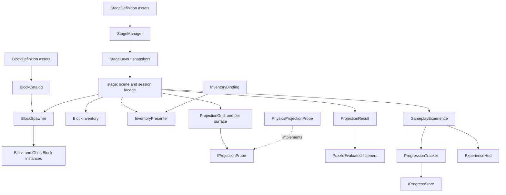

# Extending the gameplay modules

The existing `stage` component remains the scene and UI-button entry point. It composes smaller modules instead of owning stage data, piece definitions, stock, spawning, presentation and projection rules itself. This keeps existing Inspector references usable while allowing new content to be registered as assets.

The runtime types remain global C# 7.3 types under `Assets/script/Gameplay`. They stay in the existing Unity assembly: no runtime assembly definition or assembly rename is introduced. Existing script GUIDs, public legacy Inspector fields and button methods are preserved. The stored Unity version remains `2019.4.16f1`; this modularization does not claim a completed editor migration.



## Responsibilities and extension points

| Module | Owns | Keep outside this module |
| --- | --- | --- |
| `StageDefinition` | Inspector-authored stage number, starting stock and three binary patterns | Live session stock and spawned objects |
| `StageLayout` | Validated, defensive stage-data snapshot | Scene objects and rendering |
| `StageManager` | Built-in stage 101 and registered `AdditionalStages`; legacy data compatibility | Piece movement and UI layout |
| `BlockDefinition` / `BlockCatalog` | Piece IDs, prefab pairs and spawn offsets; validated lookup | Remaining stock and puzzle completion |
| `BlockInventory` | Remaining stock for the current session | Prefab instantiation and UI objects |
| `BlockSpawner` | Piece/ghost creation and ownership of spawned instances | Selecting stages and awarding points |
| `InventoryBinding` / `InventoryPresenter` | Piece-ID-to-UI bindings, counts, visibility and slot placement | Stage definitions and piece geometry |
| `ProjectionGrid` | One surface's cells, original highlight colors and binary-pattern comparison | Unity ray-query implementation and score rules |
| `IProjectionProbe` / `PhysicsProjectionProbe` | Occupancy observations / Unity physics adapter | Deciding whether a cell should be occupied |
| `ProjectionResult` | Evaluated stage ID and immutable mismatch counts for each surface | Mutable session state and progression |
| `ProgressionTracker` / `ProgressProfile` | Attempt score, stars, bests, XP and local achievement rules | Unity objects, time sources and platform accounts |
| `IProgressStore` / `PlayerPrefsProgressStore` | Persistence boundary / device-local Unity adapter | Score rules and HUD objects |
| `ExperienceHud` / `GameplayExperience` | Owned UGUI view / committed-state coordination | Native board queries and content definitions |
| `stage` | Scene bindings, session orchestration and existing button entry points | Content-specific piece switches and score policy |

`StageLayout` copies the inventory and pattern data it receives. Its inventory and pattern accessors return copies, so callers cannot rewrite an active layout by editing an array or dictionary they obtained earlier. `StageDefinition.CreateLayout(...)` is the conversion boundary from mutable Inspector data to that runtime snapshot.

The legacy fields remain a compatibility layer. Built-in piece IDs 1–7 and stage 101 still work without creating new assets. The experience also supplies short built-in challenges 102 and 103; the example below uses a new ID 202. New features should use the asset registration and query APIs rather than adding more parallel legacy fields.

## Add stage 202 in the Editor

1. Stop Play mode. In the Project window, choose **Create → Stack and Slide → Stage Definition** and name the asset `Stage202`.
2. Set `StageNumber` to `202`.
3. Fill `Inventory` with `BlockStock` entries. Each entry has a positive `BlockId` and a nonnegative `Count`. Use unique IDs; for example, `{ BlockId: 1, Count: 2 }` and `{ BlockId: 8, Count: 1 }` after registering piece 8.
4. Set `Floor`, `Wall` and `FrontWall` to 64 elements each. Use only `0` and `1`. Index order matches the corresponding `floor`, `wall` and `frontwall` Inspector arrays on the scene's `stage` component, so a row-major drawing must follow that authored ordering.
5. Add `Stage202` to `AdditionalStages` on the scene's `StageManager`.
6. Assign all inventory UI bindings and enough `Location` slots for its visible piece kinds, then enter Play mode.
7. Wire a stage-selection button to the existing `stage.SelectStage(int)` method with argument `202`.

`StageManager` overlays these definitions on its built-in catalog. A registered definition with ID 101 intentionally replaces the built-in stage data. Duplicate IDs within `AdditionalStages`, null entries and invalid patterns are errors; use one explicit definition per registered ID.

Code that needs a layout without starting gameplay can query the manager directly:

```csharp
StageLayout layout;
if (stageManager.TryGetStageLayout(202, out layout))
{
    // This is a copy; changing it does not change the registered stage.
    int[] previewFloor = layout.CopyFloor();
    ShowStagePreview(previewFloor);
}
```

The preview method in this example belongs to the consuming UI feature. It is not part of `StageManager`.

## Add piece ID 8 without editing a stage switch

1. Author a playable prefab and a matching ghost prefab, using existing piece prefabs as references. Preserve the game's controller, tag, collider and transform assumptions: enabled `Block` and `GhostBlock` controllers belong to geometry children under their respective prefab roots.
2. Choose **Create → Stack and Slide → Block Definition** and name the asset `Block8`.
3. Set `BlockId` to `8`, assign `BlockPrefab` and `GhostPrefab`, and set a finite `SpawnOffset` appropriate for the geometry's pivot.
4. Register `Block8` in `stage.AdditionalBlocks`.
5. Add an `InventoryBinding` to `stage.AdditionalInventoryBindings`. Set `BlockId` to `8`, `Image` to the piece's inventory image and `CountText` to its count label.
6. Add enough `Location` transforms to show every piece kind that can have positive stock simultaneously. Capacity depends on the number of visible kinds, not the sum of their individual counts. The existing scene has six slots; adding another simultaneously visible kind requires another slot.
7. Include ID 8 in a custom `StageDefinition.Inventory` and select that stage. The piece button calls the existing `stage.GenerateBlock(int)` method with argument `8`.

No `case 8` is needed in the scene facade. `BlockCatalog` resolves the registered definition, `BlockInventory` supplies the remaining count, `BlockSpawner` creates the matching pair and `InventoryPresenter` renders the binding.

An additional definition may intentionally override a built-in piece ID. Duplicate IDs within `AdditionalBlocks` or ambiguous UI bindings should be corrected rather than relying on registration order. Null definitions, missing controllers or prefabs, disabled required controllers and invalid offsets are rejected. A runtime definition is a validated snapshot of its ID and offset; prefab references still refer to Unity objects, so prefab validity must also be checked when spawning.

## Consume evaluation results for scoring or progression

The `stage.PuzzleEvaluated` event supplies `ProjectionResult` after evaluation. Inspect `StageNumber`, `IsSolved`, `FloorMismatches`, `WallMismatches`, `FrontWallMismatches` and `TotalMismatches` directly. Use the stage ID in the result: an earlier listener may already have selected a different stage. Do not parse the facade's diagnostic `Debug.Log` text.

The built-in `GameplayExperience` now connects `ProgressionTracker` and `ExperienceHud` automatically. Its internal commit subscriptions record a clear before a public result listener can navigate away; public listeners can implement independent feedback or progression features. Read `GameplayExperience.Profile` for defensive personal-best and achievement snapshots rather than maintaining a competing score total. See [player experience](player-experience.md) for the implemented score, star and local-save rules.

UI and feature code can also read `Puzzle.CurrentStageNumber`, `Puzzle.IsPlaying` and `Puzzle.GetRemainingBlocks(blockId)` without accessing the facade's private module instances. A result is an immutable snapshot of one evaluation; keep it if a results screen needs the three surface counts after the session changes.

Standalone callers can construct a result with only three mismatch counts; its stage ID defaults to 0, meaning no associated stage. Events from the scene facade always include the evaluated stage's positive ID.

## Validate before changing a session

Content validation belongs at the transition boundary. Validate the complete stage layout, registered piece IDs, prefabs, inventory bindings and display capacity before clearing the current board or consuming stock. A malformed replacement stage should leave the running session intact rather than partially hiding UI, repainting a grid or deleting its pieces.

Keep these invariants when adding features:

- Stage and piece IDs are positive and unambiguous; stock cannot be negative.
- Every selected layout has one binary entry per cell on each matching projection surface.
- Every stocked piece has a usable definition and an inventory presentation binding.
- Every positive-stock piece kind fits into the available inventory locations.
- Spawning either produces its complete playable/ghost pair and consumes stock once, or cleans up partial objects and leaves the stock available.
- Session teardown removes only objects owned by that session and restores colors changed by the projection modules.
- Synchronous prefab callbacks that return to the menu, select another stage or reload legacy data cancel a pending spawn. They cannot debit the replacement session's stock or leave its old clones active.
- Cleanup detaches owned references before deactivating roots. Nested transitions and public `CallVari()` reloads from cleanup or inventory UI callbacks are ignored until the current transition completes.
- A new physics backend supplies `IProjectionProbe` observations; it does not duplicate binary-pattern matching or score logic.

`BlockSpawner.CancelPendingSpawn()` invalidates a pending pair without deleting committed pieces; `Clear()` also retires all roots owned by that spawner. The scene facade uses the first operation when `CallVari()` reloads legacy data and the second when a session ends. A custom probe that changes session during evaluation invalidates that evaluation, so no obsolete result event is published.

The three grids query occupancy along each cell's local inward direction. The Unity physics adapter treats playable, newly fixed and fixed blocks as occupancy and looks through unrelated geometry and ghosts. A custom probe can return recorded observations for a tutorial, deterministic replay or another backend while leaving grid validation and result reporting intact.

## Testing and Unity validation boundaries

Use the repository's gameplay test runner to exercise the actual module source with the isolated Unity API substitutes. Add regression cases beside the module's tests when extending stage lookup, stock, spawning, UI binding or occupancy rules. A deterministic `IProjectionProbe` test should control observations independently of the grid's implementation.

These tests can verify defensive copies, invalid registration, transition atomicity, counts, event payloads and rollback behavior. They do not demonstrate that a real scene imports, real colliders behave correctly, rendered highlights are correct or an Android build runs. Fake Unity objects also cannot fully reproduce destroyed-object equality or native lifecycle scheduling.

After registering content, open `Assets/Scenes/stage1_1.unity` in the intended Unity editor and inspect Console errors. Exercise selection, generation, movement, rotation, landing, evaluation and returning to the menu. Check the custom piece's pivot and ghost alignment, all three projection surfaces, visible inventory ordering and a failed stage selection while another stage is running.

For an editor-version migration, use the separate [Unity validation guide](unity-upgrade.md). The import helper works on a disposable copy and reports its actual editor version and limitations. This architecture introduces extension points without changing `ProjectVersion.txt` or claiming that Unity 6.6, Play mode or Android validation has completed.
